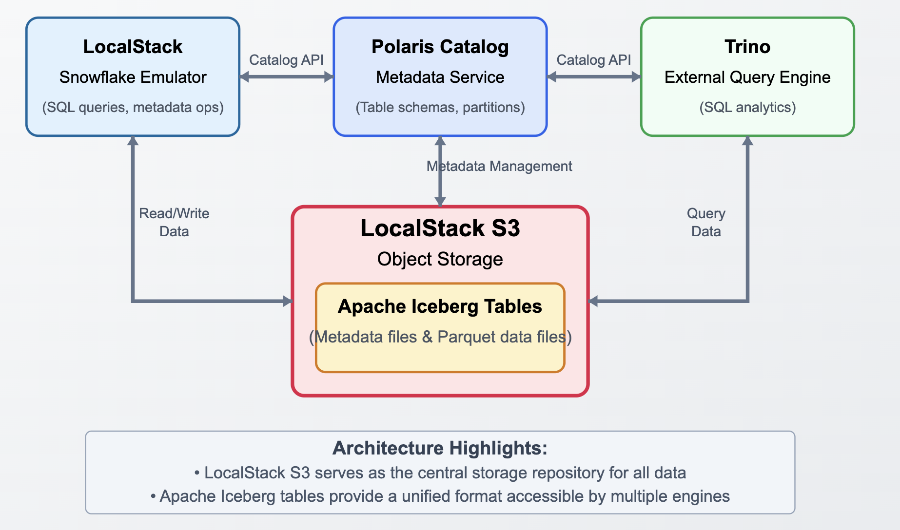

# Polaris Demo

This project demonstrates the integration of Apache Polaris with LocalStack for Snowflake and Trino for local development and testing.

## Architecture



## Components

- **Apache Polaris**: A metadata catalog service
- **LocalStack for Snowflake**: Local version of Snowflake 
- **Trino**: Distributed SQL query engine

## Prerequisites

- Docker and Docker Compose
- AWS CLI (for testing with LocalStack)
- Python 3 with `snowflake-connector-python`, to run `make test`

## LocalStack Authentication

This sample requires a valid [LocalStack for Snowflake license](https://localstack.cloud/pricing). Your license provides a [`LOCALSTACK_AUTH_TOKEN`](https://docs.localstack.cloud/aws/getting-started/auth-token/) to activate LocalStack.

## Deployment

Start LocalStack and all services with the `LOCALSTACK_AUTH_TOKEN` pre-configured:

```bash
export LOCALSTACK_AUTH_TOKEN=<your-auth-token>
make start
```

## Getting Started

1. Wait for all services to be healthy (especially Polaris). `make start` also runs the `create-polaris-catalog` container, which creates the `polaris` catalog once Polaris is healthy.

2. To run the catalog setup again, use:
   ```bash
   make run
   ```


### AWS CLI Commands

**Note:**  
This demo requires a bucket named `test-bucket` to exist in LocalStack S3.  
You can create it with:

1. Create a test bucket:
   ```bash
   aws --endpoint-url=http://localhost:4566 s3 mb s3://test-bucket
   ```

2. List objects in the bucket:
   ```bash
   aws --endpoint-url=http://localhost:4566 s3api list-objects --bucket test-bucket
   ```

3. Alternative using lstk (if installed):
   ```bash
   lstk aws s3 mb s3://test-bucket
   lstk aws s3api list-objects --bucket test-bucket
   ```

## Running the SQL Script

The file `script.sql` contains a full example workflow for setting up an external Iceberg volume, catalog integration, table creation, data insertion, and querying using Snowflake/Trino semantics with this stack.

To execute the script:

1. Ensure all services are running and the S3 bucket exists (see above).
2. Use your preferred SQL client or Snowflake CLI to connect to the appropriate service (e.g., Trino CLI or Snowflake client pointing to LocalStack/Snowflake emulator).
3. Run the commands in `script.sql` step by step, or copy-paste them into your SQL client.

**Example:**  
To run the entire script using SnowSQL, use:
```bash
snowsql -f script.sql
```
Adjust the command as needed for your SQL client and connection parameters.

**Trino CLI Example:**  
To query the Iceberg table using Trino (from the Trino container):
```bash
docker exec -it polaris-demo-trino-1 trino
```
Then, at the `trino>` prompt, run:
```sql
select * from iceberg.test_namespace.iceberg_table;
```
Expected output:
```
   c1
--------
 test
 foobar
(2 rows)
```
This demonstrates that the tables are interoperable between LocalStack Snowflake and Trino.

## Testing

`make test` runs the whole walkthrough against a freshly started stack (`make start`):

```bash
pip install snowflake-connector-python
make test
```

It checks that:
- the `polaris` catalog exists
- `script.sql` runs on LocalStack for Snowflake, and the `SELECT` returns `test` and `foobar`
- Trino reads the same rows from `iceberg.test_namespace.iceberg_table`
- the Iceberg data and metadata files are in `s3://test-bucket/test/`

The test creates `test-bucket` if it does not exist. `script.sql` is not idempotent, so run `make stop` and `make start` before running the test again.

You can also check the setup by hand:
- Accessing the Trino UI: http://localhost:8080
- Listing S3 buckets in LocalStack

## Project Structure

```
.
├── docker-compose.yml
├── create-polaris-catalog.sh
├── test.sh
├── trino-config/
│   └── catalog/
├── script.sql
└── README.md
```

## Troubleshooting

1. If services fail to start:
   - Check Docker logs: `docker compose logs`
   - Verify environment variables are set correctly
   - Ensure ports are not in use

2. If Polaris catalog creation fails:
   - Check LocalStack is running: `curl http://localhost:4566/_localstack/health`
   - Verify S3 bucket exists: `aws --endpoint-url=http://localhost:4566 s3 ls`
   - Check Polaris logs: `docker compose logs polaris` 